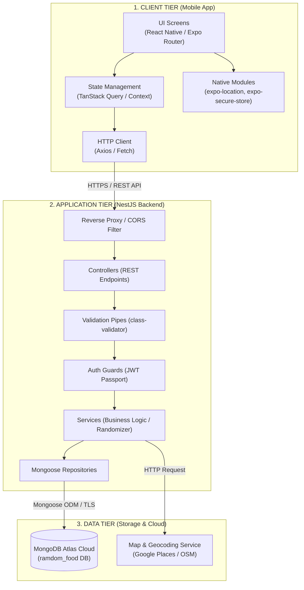

# KIẾN TRÚC HỆ THỐNG (SYSTEM ARCHITECTURE)
## Dự án: Random Food App

---

## 1. TỔNG QUAN KIẾN TRÚC

Hệ thống được thiết kế theo mô hình **Client-Server 3 tầng (3-Tier Layered Architecture)**:



---

## 2. CHI TIẾT CÁC TẦNG HỆ THỐNG

### 2.1. Mobile Client (React Native + Expo)
- **Framework:** React Native chạy trên nền Expo SDK mới nhất.
- **Routing:** **Expo Router** (File-based routing), tương tự Next.js, tạo cấu trúc thư mục rõ ràng:
  - `app/(auth)/login.tsx`, `register.tsx`
  - `app/(tabs)/index.tsx` (Màn hình chính quay món)
  - `app/(tabs)/favorites.tsx` (Màn hình danh sách yêu thích)
  - `app/(tabs)/profile.tsx` (Màn hình hồ sơ cá nhân)
  - `app/food/[id].tsx` (Màn hình chi tiết món ăn)
  - `app/places/nearby.tsx` (Màn hình tìm quán gần tôi)
- **Data Fetching & Cache:** **TanStack React Query** kết hợp Axios.
  - Tự động cache kết quả món ăn.
  - Tự động retry khi mạng chập chờn.
  - Quản lý trạng thái `isLoading`, `isError`, `isSuccess` chuẩn xác.
- **Lưu trữ cục bộ an toàn:**
  - `expo-secure-store`: Lưu JWT Access Token & Refresh Token.
  - `@react-native-async-storage/async-storage`: Lưu cài đặt bộ lọc, lịch sử offline.
- **Định vị GPS:** `expo-location` để lấy tọa độ kinh độ (`longitude`) và vĩ độ (`latitude`) của người dùng khi được cho phép.

---

### 2.2. Backend API (NestJS)
Áp dụng nguyên lý Clean Architecture / Modular Architecture trong NestJS:

```text
apps/backend/src/
├── common/
│   ├── decorators/       # @CurrentUser(), @Public()
│   ├── filters/          # AllExceptionsFilter (chuẩn hóa response lỗi)
│   ├── guards/           # JwtAuthGuard
│   └── interceptors/     # TransformInterceptor (chuẩn hóa response thành công)
├── config/               # ConfigurationModule (đọc .env, validate schema)
├── modules/
│   ├── auth/             # Login, Register, Google OAuth, JWT Strategy
│   ├── users/            # User profile, Favorites management
│   ├── foods/            # Food CRUD, Randomizer engine, Category
│   └── places/           # GPS Nearby restaurants finder
├── app.module.ts
└── main.ts
```

- **Validation Pipe:** Tự động kiểm tra tính hợp lệ của DTO qua `class-validator`, chặn dữ liệu rác trước khi vào Service.
- **Exception Filter:** Bắt mọi ngoại lệ và trả về định dạng JSON chuẩn:
  ```json
  {
    "statusCode": 400,
    "timestamp": "2026-10-18T14:45:00.000Z",
    "path": "/api/v1/foods/random",
    "message": "Validation failed: budget must be a positive number"
  }
  ```
- **API Documentation:** Tự động sinh Swagger UI tại `/api/docs` để kiểm thử và đọc tài liệu API trực tiếp trên trình duyệt.

---

### 2.3. Database (MongoDB Atlas)
- **Tên cơ sở dữ liệu:** `ramdom_food`
- **Kết nối:** `mongodb+srv://...` qua giao thức bảo mật TLS/SSL.
- **Tầng giao tiếp:** Mongoose ODM với TypeScript schema definitions.
- **Indexing:**
  - Index trường `categories`, `mealType`, `priceRange` trong collection `foods` để truy vấn ngẫu nhiên và lọc siêu nhanh.
  - Unique Index trên `email` trong collection `users`.

---

## 3. THIẾT KẾ ĐẶC BIỆT: TEST EXPO GO TRÊN ĐIỆN THOẠI THẬT
Khi phát triển mobile app bằng Expo Go và backend NestJS trên cùng máy dev (Windows):
- Điện thoại thật và máy tính cùng kết nối vào một mạng Wi-Fi cục bộ.
- Điện thoại **không thể** gọi tới `http://localhost:3000` (vì localhost trên điện thoại trỏ về chính nó).
- **Giải pháp:** Sử dụng biến môi trường `EXPO_PUBLIC_API_URL` trỏ tới IP mạng LAN của máy dev:
  `http://192.168.1.3:3000/api/v1` (hoặc cấu hình dynamic lookup trong Expo config).

---

## 4. CHIẾN LƯỢC TÌM KIẾM QUÁN ĂN XUNG QUANH (GPS NEARBY)
Khi người dùng quay được món ăn (ví dụ: *"Bún chả"*), ứng dụng hỗ trợ 2 cơ chế linh hoạt:
1. **In-App Nearby Finder (API Backend):**
   - Backend tiếp nhận tọa độ `(lat, lng)` và từ khóa món ăn `foodName`.
   - Gọi dịch vụ định vị (OpenStreetMap Overpass API miễn phí hoặc Google Places API khi có key) để tìm quán trong bán kính 1km - 3km.
2. **Deep-linking Direct to Google Maps / Apple Maps:**
   - Ứng dụng cung cấp nút bấm tiện ích: *"Xem đường đi trên Google Maps"*.
   - Mở ứng dụng bản đồ gốc của điện thoại thông qua URL Scheme:
     `https://www.google.com/maps/search/?api=1&query={foodName}+near+me`
   - **Ưu điểm:** Trải nghiệm điều hướng thời gian thực, xem review quán ăn chuẩn xác nhất mà không tốn chi phí API.
