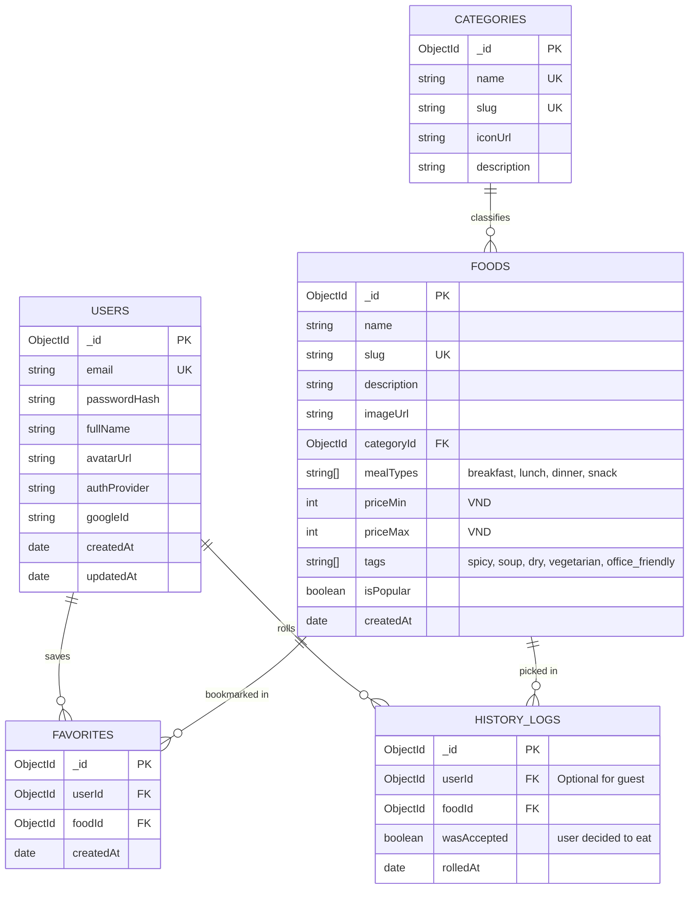

# THIẾT KẾ CƠ SỞ DỮ LIỆU (DATABASE SCHEMA SPECIFICATION)
## Database: MongoDB Atlas (`ramdom_food`)

---

## 1. SƠ ĐỒ QUAN HỆ THỰC THỂ (ERD)

---

## 2. CHI TIẾT COLLECTIONS & MONGOOSE SCHEMAS

### 2.1. Collection: `users`
Lưu trữ thông tin người dùng và tài khoản xác thực.

| Trường | Kiểu dữ liệu | Bắt buộc | Mặc định | Mô tả |
| :--- | :--- | :--- | :--- | :--- |
| `_id` | `ObjectId` | Có | Tự động | Khóa chính |
| `email` | `String` | Có | Không | Email duy nhất (`unique: true`, `lowercase: true`, `trim: true`) |
| `passwordHash` | `String` | Không | `null` | Mật khẩu đã băm bcrypt (null nếu dùng Google OAuth) |
| `fullName` | `String` | Có | Không | Họ và tên hiển thị |
| `avatarUrl` | `String` | Không | `null` | Link ảnh đại diện |
| `authProvider` | `String` | Có | `'local'` | `'local'` \| `'google'` |
| `googleId` | `String` | Không | `null` | ID tài khoản Google (nếu đăng nhập bằng Google) |
| `isActive` | `Boolean` | Có | `true` | Trạng thái kích hoạt |
| `createdAt` | `Date` | Có | `Date.now` | Thời gian tạo tài khoản |
| `updatedAt` | `Date` | Có | `Date.now` | Thời gian cập nhật gần nhất |

**Indexes:**
- `{ email: 1 }` (Unique)
- `{ googleId: 1 }` (Sparse)

---

### 2.2. Collection: `categories`
Phân loại nhóm món ăn (Cơm, Bún/Phở, Mì/Miến, Đồ ăn nhanh, Đồ uống, v.v.).

| Trường | Kiểu dữ liệu | Bắt buộc | Mô tả |
| :--- | :--- | :--- | :--- |
| `_id` | `ObjectId` | Có | Khóa chính |
| `name` | `String` | Có | Tên phân loại (ví dụ: *"Cơm văn phòng"*, *"Bún & Phở"*) |
| `slug` | `String` | Có | URL-friendly slug (ví dụ: `com-van-phong`) |
| `icon` | `String` | Không | Tên icon hoặc link hình đại diện |
| `sortOrder` | `Number` | Có | Thứ tự sắp xếp hiển thị (mặc định: `0`) |

**Indexes:**
- `{ slug: 1 }` (Unique)

---

### 2.3. Collection: `foods`
Lưu trữ danh mục món ăn và các thuộc tính phục vụ bộ lọc ngẫu nhiên.

| Trường | Kiểu dữ liệu | Bắt buộc | Mặc định | Mô tả |
| :--- | :--- | :--- | :--- | :--- |
| `_id` | `ObjectId` | Có | Tự động | Khóa chính |
| `name` | `String` | Có | Không | Tên món ăn (ví dụ: *"Cơm tấm sườn bì chả"*, *"Bún chả Hà Nội"*) |
| `slug` | `String` | Có | Không | Slug duy nhất (`unique: true`) |
| `description` | `String` | Không | `""` | Giới thiệu ngắn về món |
| `imageUrl` | `String` | Có | Không | URL hình ảnh món ăn chất lượng cao |
| `categoryId` | `ObjectId` | Có | Không | Tham chiếu tới `categories._id` |
| `mealTypes` | `[String]` | Có | `['lunch', 'dinner']` | Các bữa phù hợp: `['breakfast', 'lunch', 'dinner', 'snack']` |
| `priceMin` | `Number` | Có | `30000` | Mức giá tối thiểu ước tính (VND) |
| `priceMax` | `Number` | Có | `50000` | Mức giá tối đa ước tính (VND) |
| `tags` | `[String]` | Không | `[]` | Thuộc tính lọc: `['spicy', 'non_spicy', 'soup', 'dry', 'office_favorite']` |
| `isPopular` | `Boolean` | Có | `false` | Đánh dấu món ăn phổ biến được yêu thích |
| `createdAt` | `Date` | Có | `Date.now` | Thời gian tạo |

**Indexes:**
- `{ mealTypes: 1, priceMax: 1 }` (Compound index phục vụ query random lọc theo bữa và giá)
- `{ tags: 1 }` (Index phục vụ query theo tag)
- `{ categoryId: 1 }`

---

### 2.4. Collection: `favorites`
Lưu danh sách món yêu thích của từng người dùng.

| Trường | Kiểu dữ liệu | Bắt buộc | Mô tả |
| :--- | :--- | :--- | :--- |
| `_id` | `ObjectId` | Có | Khóa chính |
| `userId` | `ObjectId` | Có | Tham chiếu tới `users._id` |
| `foodId` | `ObjectId` | Có | Tham chiếu tới `foods._id` |
| `createdAt` | `Date` | Có | Thời điểm thêm vào yêu thích |

**Indexes:**
- `{ userId: 1, foodId: 1 }` (Compound Unique Index: Mỗi người dùng chỉ bookmark 1 món một lần)

---

### 2.5. Collection: `history_logs`
Ghi nhận lịch sử mỗi lần bấm quay và người dùng có chấp nhận món đó hay không (dùng để gợi ý thông minh, tránh lặp lại món vừa ăn ngày hôm trước).

| Trường | Kiểu dữ liệu | Bắt buộc | Mô tả |
| :--- | :--- | :--- | :--- |
| `_id` | `ObjectId` | Có | Khóa chính |
| `userId` | `ObjectId` | Không | Tham chiếu `users._id` (hoặc null nếu là khách vãng lai) |
| `foodId` | `ObjectId` | Có | Món ăn được random ra |
| `wasAccepted` | `Boolean` | Có | `true` nếu người dùng chọn ăn món này, `false` nếu quay tiếp |
| `rolledAt` | `Date` | Có | Thời điểm quay (`Date.now`) |

**Indexes:**
- `{ userId: 1, rolledAt: -1 }`
