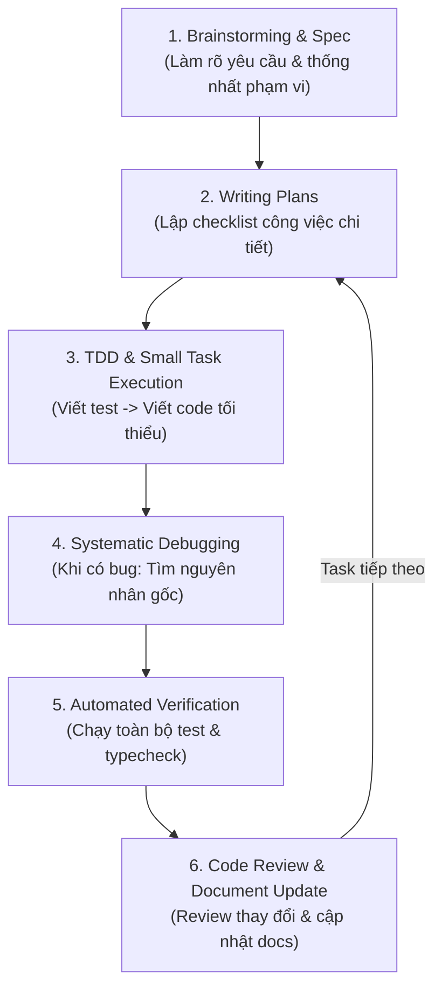

# QUY TRÌNH PHÁT TRIỂN VỚI SUPERPOWERS (DEVELOPMENT WORKFLOW)
## Dự án: Random Food App

---

## 1. NGUYÊN TẮC VẬN HÀNH DỰ ÁN CÙNG AI & SUPERPOWERS

Để đảm bảo dự án phát triển bài bản, không bao giờ rơi vào tình trạng "code loạn xạ rồi sửa chắp vá", AI Agent và Lập trình viên sẽ phối hợp theo quy trình 6 bước khép kín:



---

## 2. CHI TIẾT CÁC GIAI ĐOẠN

### Bước 1: Brainstorming & Requirements (`superpowers:brainstorming`)
- Trước khi bắt đầu một tính năng mới, AI dừng lại phân tích: *"Tính năng này giải quyết điều gì? Có những trường hợp ngoại lệ nào?"*.
- Hỏi người dùng để làm rõ các điểm chưa rõ trước khi lập trình.

### Bước 2: Lập kế hoạch chi tiết (`superpowers:writing-plans`)
- Chia nhỏ tính năng thành các task độc lập, mỗi task chỉ mất 10 - 30 phút triển khai.
- Duy trì danh sách công việc trong Task Tracking Artifact:
  ```markdown
  - [ ] Task 1: Khởi tạo DTO và Schema Mongoose
  - [ ] Task 2: Viết Unit Test cho FoodService
  - [ ] Task 3: Triển khai FoodService để test pass
  - [ ] Task 4: Khởi tạo Controller và Swagger Docs
  ```

### Bước 3: Triển khai theo TDD (`superpowers:test-driven-development`)
- **Red:** Viết unit test mô tả hành vi mong muốn trước khi viết code nghiệp vụ.
- **Green:** Viết code vừa đủ để test chuyển sang màu xanh (Pass).
- **Refactor:** Tối ưu hóa code, chuẩn hóa đặt tên, loại bỏ mã thừa mà test vẫn pass.

### Bước 4: Điều tra lỗi có hệ thống (`superpowers:systematic-debugging`)
- Khi gặp lỗi:
  1. Đọc kỹ thông báo lỗi và stack trace.
  2. Tái hiện lỗi bằng một test case cụ thể.
  3. Tìm nguyên nhân gốc rễ (Root Cause) trước khi sửa bất kỳ dòng code nào.
  4. Tuyệt đối không thử nghiệm sửa hú họa hoặc che giấu lỗi bằng `try/catch` rỗng.

### Bước 5: Xác minh bằng chứng (`superpowers:verification-before-completion`)
- Trước khi tuyên bố task hoàn thành:
  - Chạy `npm.cmd test` và kiểm tra 100% test pass.
  - Chạy TypeScript type-check (`tsc --noEmit`) để đảm bảo không còn lỗi cú pháp kiểu dữ liệu.

### Bước 6: Review & Hoàn thiện (`superpowers:requesting-code-review`)
- Đánh giá mã nguồn theo các tiêu chí:
  - Có hardcode secret hay URL không?
  - Có xử lý các trường hợp null/undefined không?
  - Giao diện có hiển thị loading spinner và thông báo lỗi thân thiện không?
